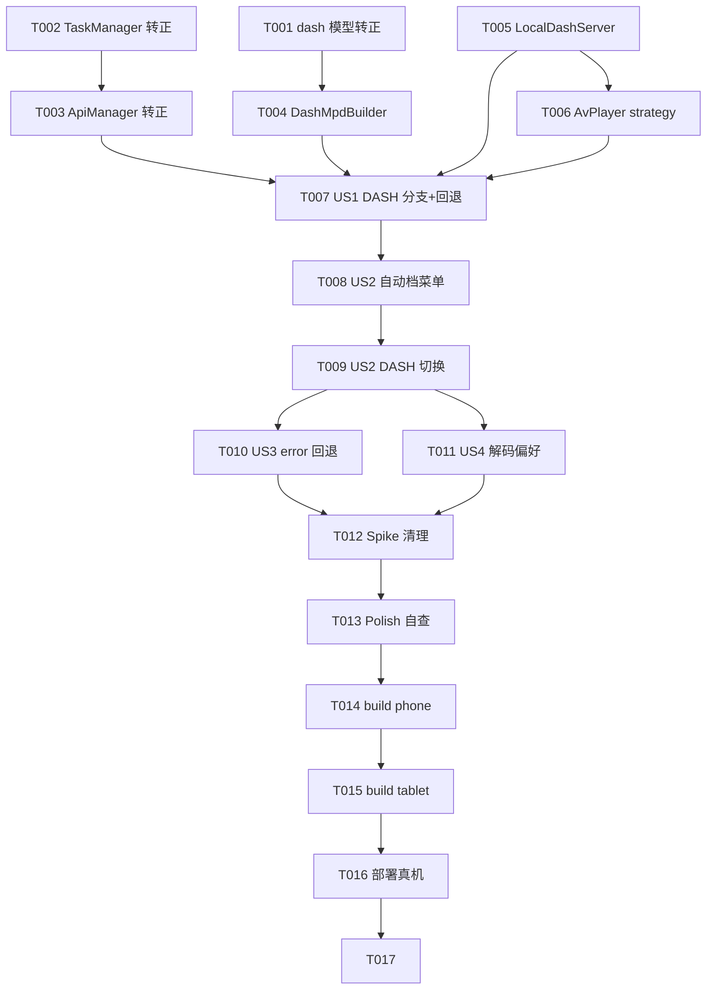

# Tasks: DASH 取流与高清播放（Dash Playback）

**Input**: Design documents from `spec/dash-playback/`
**Prerequisites**: plan.md (required), spec.md (required for user stories)

## Format: `[ID] [P?] [Story] Description`

- **[P]**: Can run in parallel (different files, no dependencies)
- **[Story]**: Which user story this task belongs to (e.g. US1, US2, US3)
- Include exact file paths in descriptions

## Path Conventions

- 公共代码：`common/src/main/ets/`（HAR）；页面：`product/phone/src/main/ets/`
- 响应模型：`common/src/main/ets/model/response/`；网络层：`common/src/main/ets/network/`；播放器：`common/src/main/ets/player/`
- 参考实现：`product/phone/src/main/ets/pages/DashSpike.ets`（spike 分支 `test/dash-spike`，spike 已真机验证；正式实现以此为蓝本抽取，完成后删除）
- 文中所有路径均相对仓库根 `F:\Work\OHProj\OhBili`
- 每个涉及 .ets 的任务完成后必须执行：`devecocli check arkts <本任务编辑的文件列表>`；阶段完成后 `devecocli build --modules phone`
- **禁止**使用 PowerShell 管道（Get-Content/Set-Content）改写源码（UTF-8 乱码），一律用 Write/Edit 工具

---

## Phase 1: Foundational (Blocking Prerequisites)

**Purpose**: 模型与网络链路转正、MPD 构建器与本地服务就绪

**⚠️ CRITICAL**: 本阶段完成前不得开始任何用户故事

- [ ] T001 [P] 转正 `common/src/main/ets/model/response/PlayUrlResponse.ts`：按 plan.md Data Model 补全 BiliDash/BiliDashStream/BiliDashAudioStream/BiliSegmentBase/BiliDashDolby 字段（BiliDashAudioStream 与 BiliDashStream 分离，音频无 width/height），PlayUrl 增补 `dash?: BiliDash | null`，去除 SPIKE 注释心智，风格对齐现有 interface 模型
- [ ] T002 [P] 转正 `common/src/main/ets/network/TaskManager.ts` 中 DASH playurl task（约 350 行与 1411 行两处 SPIKE 段）：参数 bvid/cid/qn，query `fnval=4048&fourk=1`，保留登录 Cookie 头模式，去 SPIKE 注释
- [ ] T003 [P] 转正 `common/src/main/ets/network/ApiManager.ets` 的 `requestPlayUrlWbiDash(bvid: string, cid: number, qn: number): Promise<PlayUrlResponse | null>`（约 181 行 SPIKE 段）：失败/业务码非 0 返回 null，BLog 日志，模式对齐现有方法；顺带确认 requestPlayUrlWbiMp4 的 code 判断 bug 不在本期修复范围（不动）
- [ ] T004 创建 `common/src/main/ets/player/DashMpdBuilder.ets`：`static build(dash: BiliDash, opts: DashMpdOptions): string` + `DashMpdOptions` interface（proxyBase/codecPreference/pinQn）；实现 R5 编码过滤降级链（codecs 前缀 avc1/hev1|hvc1/av01）、R6 pinQn 收敛（-1 全量 / >0 仅 id==pinQn）、`\u0026` 双重转义还原、代理 URL 重写（`proxyBase + '/seg?url=' + encodeURIComponent(fixedUrl)`）、XML 转义、音频取 bandwidth 最高（跳过 dolby/flac）、MPD 时长取 `dash.duration`；无可用视频 Representation 返回 `''`；在 `common/src/main/ets/Index.ets` 导出 DashMpdBuilder 与 DashMpdOptions
- [ ] T005 创建 `common/src/main/ets/player/LocalDashServer.ets`：`start(): Promise<number>`（127.0.0.1，端口 34567 起 +1 重试 ≤10，失败 resolve -1）、`stop(): void`、`updateMpd(mpd: string): void`；HTTP 处理：`GET /dash.mpd`（200，`application/dash+xml`，Connection: close）、`GET /seg?url=`（域名后缀白名单 `.bilivideo.com/.bilivideo.cn/.akamaized.net/.hdslb.com`，非白名单 403；http kit 上游注入项目 UA 与 `Referer: https://www.bilibili.com`，透传 Range；上游状态码/Content-Range/Content-Type/Content-Length 从 `JSON.stringify(resp.header)` 解析回传；上游非 200/206 或异常回 502 并关闭连接）；连接必须始终以响应+close 结束（无悬挂，Review Focus 2/5）；蓝本：DashSpike.ets 的 handleHttpData/proxySegment/extractHeaderValue/sendHttpBody；在 `common/src/main/ets/Index.ets` 导出 LocalDashServer

**Checkpoint**: `devecocli check arkts` 全绿 + `devecocli build --modules phone` 通过；五件套可独立调用（模型/请求/构建/服务）

---

## Phase 2: User Story 1 - DASH 播放管线 (Priority: P1) 🎯 MVP

**Goal**: 普通视频走 DASH 管线起播（本地 MPD + 段代理 + PlaybackStrategy），失败回退 durl

**Independent Test**: 登录态播放任意普通视频 → 日志显示 dash 取流/MPD 更新/代理 206 → 正常出画播放；构造失败（如断网起播）→ 自动落回 durl 链路仍可播

- [ ] T006 [US1] 修改 `common/src/main/ets/player/AvPlayer.ets`：`setDataSource(url: string, headers?: Map<string, string>, strategy?: PlaybackStrategy): void`（applySource 内 strategy 存在时 `setMediaSource(mediaSource, strategy)`，否则维持现有单参调用； PlaybackStrategy 从 `@kit.MediaKit` 导入类型）
- [ ] T007 [US1] 修改 `common/src/main/ets/components/video/Player.ets` getPlayUrl(bvid, cid)：epId>0 番剧分支不动；新增 DASH 前置尝试——读 `ohBiliPlayQn`（≤0 视为自动，请求 qn=120；>0 请求该 qn）→ `requestPlayUrlWbiDash` 非 null 且 `data.dash?.video` 非空 → `updateQualityInfo(resp.data)`（FR-006：菜单数据源同步自 dash 响应）→ `mDashServer.start()` ≥0 → `DashMpdBuilder.build`（codecPreference 读 `ohBiliCodecPreference` 默认 'avc1'，pinQn=记忆 qn 或 -1）非空 → `updateMpd` → 置 `mDashActive=true` → `initPlay('http://127.0.0.1:{port}/dash.mpd', undefined, strategy)`（自动档 strategy preferred 1280x720，锁定档可不传）；任一步失败 → `mDashActive=false` 落入现有 durl 链路（原代码不动）；新增成员 mDashServer/mDashActive/mDashFallbackUsed；播放器 release/销毁路径调用 `mDashServer.stop()`

**Checkpoint**: MVP 达成——DASH 起播 + durl 回退（真机验证：SC-001/SC-005 初步）

---

## Phase 3: User Story 2 - 清晰度菜单「自动」档与 DASH 切换 (Priority: P1)

**Goal**: 清晰度菜单含「自动」（默认）；手动档 DASH 重建 MPD 锁定并续播

**Independent Test**: 播放中开清晰度菜单 → 默认「自动」打勾 → 选 1080P → 短暂加载后 1080P 锁定续播（进度偏差 ≤1s）→ 切回「自动」→ ABR 恢复自适应

- [ ] T008 [US2] 修改 `common/src/main/ets/components/video/Player.ets`（PlayerControlView 清晰度菜单）：首行新增「自动」（qn=-1），`ohBiliPlayQn<=0` 时打勾；`isVipQn`/`qualitySelectable` 对 -1 直接放行；菜单行右侧当前值在自动档显示「自动」
- [ ] T009 [US2] 修改 `common/src/main/ets/components/video/Player.ets` switchQuality(qn)：DASH 激活分支——qn=-1（自动）：`requestPlayUrlWbiDash(bvid, cid, 120)` 全量重建 MPD（pinQn=-1）+ `switchSourceResume(curMs)`；qn>0（手动）：`requestPlayUrlWbiDash(bvid, cid, qn)` 重建 MPD（pinQn=qn）+ `switchSourceResume(curMs)`；两分支均写 `AppStorage.setOrCreate('ohBiliPlayQn', qn)`（自动写 -1）；服务端档位回退提示沿用 toastQualityFallback；DASH 未激活（已回退 durl）时维持现有 durl 切换逻辑（-1 视为回到现有默认链路取流）；番剧 switchQuality 分支不动

**Checkpoint**: SC-003 达成——自动/手动切换进度偏差 ≤1s、弹幕连续（真机验证）

---

## Phase 4: User Story 3 - 播放错误自动回退 (Priority: P1)

**Goal**: DASH 播放 error 自动回退 durl 续播，一次防循环

**Independent Test**: DASH 播放中人为断开（如代理上游持续失败/飞行模式快速切换触发 error）→ 自动转 durl 从当前进度续播 → 后续 error 不再循环切换

- [ ] T010 [US3] 修改 `common/src/main/ets/components/video/Player.ets` 播放 error 回调（AvPlayer stateChange error 分支）：`mDashActive && !mDashFallbackUsed` → 置 `mDashFallbackUsed=true`、`mDashActive=false` → 取当前进度 → 现有 durl 取流（requestPlayUrl）→ `switchSourceResume(curMs)`；切集/切视频入口（cid/epId 变更处）重置 `mDashActive=false`、`mDashFallbackUsed=false`（R9）

**Checkpoint**: SC-005 达成——DASH 不可用 100% 回退可播且无循环（真机验证）

---

## Phase 5: User Story 4 - 解码偏好设置 (Priority: P2)

**Goal**: 设置面板「解码偏好」三选（AVC/HEVC/AV1，默认 AVC），变更即时生效

**Independent Test**: 设置面板点「解码偏好」→ 选 HEVC → 短暂加载后按 HEVC 流续播；重启后偏好保持；选设备不支持档（如模拟器选 AV1）→ 自动降级仍可播

- [ ] T011 [US4] 修改 `common/src/main/ets/components/video/Player.ets`（PlayerControlView 设置面板）：新增「解码偏好」行（AVC/HEVC/AV1 三选弹层或循环切换，与现有设置行风格一致），读写 `ohBiliCodecPreference`（默认 'avc1'）；变更后立即以当前清晰度档位走 switchQuality 链路重建 MPD 生效

**Checkpoint**: US4 完成（真机验证编码切换与降级）

---

## Phase 6: Spike 清理 (FR-011)

**Purpose**: 参考代码退场，仓库无 spike 残留

- [ ] T012 删除 `product/phone/src/main/ets/pages/DashSpike.ets`；移除 `product/phone/src/main/resources/base/profile/main_pages.json` 的 pages/DashSpike 注册；还原 `product/phone/src/main/ets/pages/Splash.ets` 直跳 pages/Index（约 44 行 SPIKE 注释段）；清理 `common/Index.ets`、`ApiManager.ets`、`TaskManager.ts`、`PlayUrlResponse.ts` 残余 SPIKE 注释；全仓 grep `SPIKE`/`DashSpike` 零残留（SC-006）

**Checkpoint**: SC-006 达成

---

## Phase 7: Polish & Cross-Cutting Concerns

**Purpose**: 跨任务质量兜底

- [ ] T013 静态自查全部新增/修改文件（Review Focus 逐项）：① 播放器销毁竞态——server.stop() 后到达的异步回调不触碰 UI/不重试（对齐 AvPlayer isReleased 模式）；② 代理无悬挂连接（异常路径必回 502/403 并 close）；③ `\u0026` 还原覆盖 baseUrl 与 backupUrl；④ 快速切台时旧段请求与新 MPD 并存无害；⑤ 白名单不可绕过；同时确认 ArkTS 约束（无 any/未类型化对象字面量/动态属性访问）与 tablet 模块零引用新增符号

---

## Phase 8: Verification

<!-- verification_scope: build+ui -->

**Purpose**: 构建、部署并真机验证全链路

- [ ] T014 `devecocli build --modules phone`（必要时迭代修复直至成功）
- [ ] T015 回归构建 tablet（common HAR 改动）：`devecocli build --modules tablet`
- [ ] T016 部署真机（nova 14 Ultra）：`devecocli run --skip-build`
- [ ] T017 真机 UI 验收（SC 对应）：① 登录播放普通视频 DASH 起播 ≤5s（SC-002）；② 清晰度菜单「自动」默认、切 1080P 续播偏差 ≤1s（SC-003）；③ 连播 10 分钟无规律卡顿、ABR 升档生效（SC-004）；④ 番剧播放回归正常（durl 链路无损）；⑤ DASH 失败场景回退可播（SC-005）；⑥ 解码偏好切换生效且不支持时降级可播

---

## Dependencies & Execution Order

### Phase Dependencies

- **Foundational (Phase 1)**: 立即开始；T001–T003 三文件可并行，T004/T005 依赖 T001（BiliDash 模型定型）但互相独立可并行
- **US1 (Phase 2)**: 依赖 Phase 1 全部（T006 依赖 T005 的端口/start 契约，T007 依赖 T003/T004/T005/T006）
- **US2 (Phase 3)**: 依赖 T007（DASH 分支存在）；T008/T009 同文件（Player.ets）串行
- **US3 (Phase 4)**: 依赖 T007；与 Phase 3 同文件串行
- **US4 (Phase 5)**: 依赖 T009（switchQuality DASH 分支）
- **Spike 清理 (Phase 6)**: 依赖 Phase 2–5 全部完成（蓝本不再需要）
- **Polish (Phase 7)** → **Verification (Phase 8)**: 串行收尾

### User Story Dependencies

- **US1 (P1)**: 核心切片；US2/US3/US4 全部依赖它
- **US2 (P1)**: 依赖 US1；T008（菜单）与 T009（切换逻辑）串行
- **US3 (P1)**: 依赖 US1 的 mDashActive 标记（T007）
- **US4 (P2)**: 依赖 US2 的 switchQuality DASH 分支（T009）

### Within Each User Story

- Player.ets 为单文件多故事串行增量（T007→T008→T009→T010→T011）
- 每个 Phase 完成后在 checkpoint 真机单独验证

---

## 📊 Dependency Graph

## ⚡ Parallel Execution Guide

| Phase | Tasks | Required Files | Execution Notes |
|---|---|---|---|
| Foundational | T001, T002 | PlayUrlResponse.ts / TaskManager.ts | 不同文件，可并行 |
| Foundational | T004, T005 | DashMpdBuilder.ets / LocalDashServer.ets | T001 完成后可并行 |

## Summary Report

- **总任务数**: 17（T001–T017）
- **每故事任务数**: US1=2 / US2=2 / US3=1 / US4=1 / Foundational=5 / 清理=1 / Polish=1 / Verification=4
- **并行机会**: T001+T002；T004+T005
- **独立测试标准**: 每个 Phase checkpoint 均可在真机单独验证（见各 Phase Independent Test）
- **建议 MVP 范围**: T001–T007（DASH 起播 + durl 回退）

## Notes

- Player.ets 为单文件多故事串行增量（T007→T011），同文件任务不可并行
- DashSpike.ets 是蓝本不是依赖：Phase 6 前保留在仓，正式实现完成后删除
- 状态管理保持 V1，不得混入 V2 装饰器；番剧（epId>0）与 tablet 模块不接 DASH
- requestPlayUrlWbiMp4 的 code 判断 bug（retrofit HTTP 状态码误当业务码）不在本期修复，留待专项
