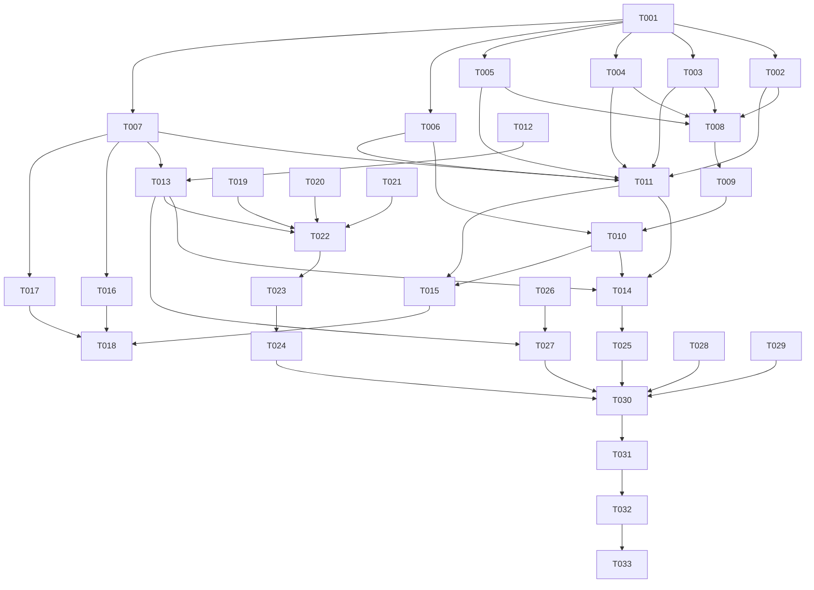

# Tasks: 动态页与个人主页（用户空间）

**Input**: Design documents from `spec/dynamic-user-space/`
**Prerequisites**: plan.md（已批准）、spec.md（已批准）
**Verification Scope**: build+ui（用户已选择 Run verification + UI verification）

**Organization**: 任务按用户故事分组（US1–US6，优先级 P1→P2→P3），每故事可独立实现与验证。MVP = Setup + Foundational + US1。

## Format: `[ID] [P?] [Story] Description`

- **[P]**: 可并行（不同文件、无未完成依赖）
- **[Story]**: 所属用户故事（US1–US6）
- 所有路径相对仓库根 `F:\Work\OHProj\OhBili`

## Path Conventions

- common HAR：`common/src/main/ets/`（模型 `model/response/*.ts`、数据源 `model/*.ets`、网络 `network/Api.ts|TaskManager.ts|ApiManager.ets`、组件 `components/**`、工具 `utils/*.ets`）
- common 导出入口：`common/Index.ets`（HAR 根，`oh-package.json5` 的 `main`）
- phone 页面：`product/phone/src/main/ets/pages/*.ets`；路由注册 `product/phone/src/main/resources/base/profile/main_pages.json`
- tablet：`product/tablet/` 零改动（仅回归构建）

---

## Phase 1: Setup（基线）

**Purpose**: 基线构建验证，作为后续修复对照

- [X] T001 基线构建验证：运行 `devecocli build --modules phone` 确认当前工作区（含播放器改造）基线可构建，作为后续修复对照

---

## Phase 2: Foundational（阻塞性基础）

**Purpose**: 4 个响应模型 + 4 个 API 端点 + 网络层 3 方法 + 数据源 + 设备门禁导航

**⚠️ CRITICAL**: 本阶段全部完成前，任何用户故事不得开始

- [X] T002 [P] 新增动态流响应模型（DynamicFeedResponse/DynamicFeedData/DynamicItem/DynamicModules/ModuleAuthor/ModuleDynamic/DynamicDesc/DynamicMajor 及 archive/draw/opus/article/pgc/ugc_season/live 全主体、ModuleStat，字段按 plan.md Data Model，可缺失字段一律可选）到 common/src/main/ets/model/response/DynamicFeedResponse.ts
- [X] T003 [P] 新增空间资料响应模型（SpaceAccInfoResponse/SpaceAccInfo）与聚合模型 SpaceUserProfile（mid/name/face/sign/level/following/follower/likeNum/archiveCount/profileLoaded）到 common/src/main/ets/model/response/SpaceAccInfoResponse.ts
- [X] T004 [P] 新增投稿列表响应模型（SpaceArcSearchResponse/SpaceArcData/SpaceArcItem，含 list.vlist 与 page 分页结构）到 common/src/main/ets/model/response/SpaceArcSearchResponse.ts
- [X] T005 [P] 新增投稿列表降级响应模型（SeriesArchivesResponse/SeriesArchivesData/SeriesArchiveItem）到 common/src/main/ets/model/response/SeriesArchivesResponse.ts
- [X] T006 [P] 在 common/src/main/ets/model/DataSourceManager.ets 新增 DynamicDataSource 与 SpaceArcDataSource（BasicDataSource 子类，对齐既有 ReplyDataSource 模式），并提供 getDynamicSource() 与 getSpaceArcSource(mid)（按 mid 实例隔离）
- [X] T007 [P] 新增设备门禁导航工具 NavHelper（goUserSpace(mid) / goGallery(urls, index)：仅 `deviceInfo.deviceType === 'phone'` 时 router.pushUrl，否则 BLog 记录后静默返回）到 common/src/main/ets/utils/NavHelper.ets
- [X] T008 在 common/src/main/ets/network/Api.ts 的 DataService 新增 4 个 GET 端点声明：`x/polymer/web-dynamic/v1/feed/all`（@Header Cookie、timezone_offset=-480、offset、features=itemOpusStyle、@Headers UA+Referer https://t.bilibili.com）、`x/space/wbi/acc/info`（Cookie、mid、w_rid、wts）、`x/space/wbi/arc/search`（Cookie、mid、pn、ps=30、order=pubdate、w_rid、wts）、`x/series/recArchivesByKeywords`（mid、keywords=''、ps=30、pn），响应类型分别绑定 T002–T005 模型（依赖 T002–T005）
- [X] T009 在 common/src/main/ets/network/TaskManager.ts 新增 4 个 taskPool 并发任务与包装方法：requestDynamicFeed(cookie, offset)、requestSpaceAccInfo(cookie, mid, wRid, wts)、requestSpaceArcSearch(cookie, mid, pn, ps, order, wRid, wts)、requestSeriesArchives(mid, pn, ps)，对齐既有任务模式（并发任务函数仅可引用导入变量，主线程解析）（依赖 T008）
- [X] T010 在 common/src/main/ets/network/ApiManager.ets 新增 3 个方法（依赖 T006、T009；Cookie 复用 LoginHelper.buildCookieHeader()，WBI 复用 WbiSigner.signParams）：
  - requestDynamicFeed(offset, isRefresh): 成功写入 DynamicDataSource（刷新清空重填/追加），返回轻量结果对象 `{ hasMore: boolean, nextOffset: string }`，登录失效（code=-101）返回明确失败标志
  - requestSpaceInfo(mid): 拉 acc/info（WBI 对 {mid} 签名）+ 既有 requestUserCardInfo（card 接口）组装 SpaceUserProfile；acc/info 失败时以 card 兜底（profileLoaded=false，签名/等级占位"--"）
  - requestSpaceArchives(mid, isRefresh): arc/search 主（WBI 对全参数签名）+ series/recArchivesByKeywords 降级（code=-352 风控或异常时切换）；成功写入 SpaceArcDataSource；返回是否还有更多
- [X] T011 [P] 在 common/Index.ets 导出 T002–T005 新模型与 SpaceUserProfile、T006 的 DynamicDataSource/SpaceArcDataSource、T007 的 NavHelper（依赖 T002–T007）

**Checkpoint**: 基础设施就绪，用户故事可开始（US1/US2 可并行）

---

## Phase 3: User Story 1 - 浏览视频类动态 (P1) 🎯 MVP

**Goal**: 已登录用户在动态 tab 看到关注 UP 主的视频投稿动态卡片，点击进入播放页
**Independent Test**: 登录 → 动态 tab 出现视频动态卡片（封面/标题/时长/数据/UP 主/时间）→ 点击卡片进入播放页正常播放 → 点击 UP 主头像/昵称进入其空间页（空间页渲染由 US2 提供，此处仅验证跳转发起）

- [X] T012 [P] [US1] 新增视频动态卡片组件 DynamicVideoCard（参数 archive+author：封面 16:9 + 时长角标 + 标题 + 播放/弹幕数；点击复用 EmptyBaseVideo(bvid) 构造 BaseVideo（填充 title/pic/duration/owner/stat 已知字段）跳转 pages/Video）到 common/src/main/ets/components/dynamic/DynamicVideoCard.ets
- [X] T013 [US1] 新增动态条目分发容器 DynamicItemView（参数 item: DynamicItem：作者栏头像+昵称+pub_time+pub_action，点击 → NavHelper.goUserSpace(module_author.mid)；major.archive 存在 → DynamicVideoCard；其余类型暂以作者栏+文字降级渲染（不崩溃不空白）；底部数据栏转发/评论/点赞计数，缺失显示"--"）到 common/src/main/ets/components/dynamic/DynamicItemView.ets，并在 common/Index.ets 追加导出 DynamicItemView（依赖 T007、T012）
- [X] T014 [US1] 重写动态页 product/phone/src/main/ets/pages/Moments.ets：未登录保留现有登录引导（文案/按钮/跳转 pages/Login 不变，不发起动态请求）；已登录 = OhNavBar + HomePullToRefresh + DynamicDataSource + LazyForEach + DynamicItemView（key 用 id_str）；onRefresh 调 ApiManager.requestDynamicFeed('', true) 加载首页；空列表空态"暂无动态，去关注喜欢的UP主吧"；请求失败/登录失效错误态可重试（登录失效引导重新登录，非死循环加载）（依赖 T010、T011、T013）

**Checkpoint**: MVP 可用——动态 tab 视频动态浏览 + 进播放页 + 发起空间页跳转

---

## Phase 4: User Story 2 - 查看任意用户个人主页 (P1)

**Goal**: 通用用户空间页：资料头 + 关注/粉丝/获赞三列数据 + 投稿视频网格（分页），三入口可达
**Independent Test**: 视频播放页点 UP 主昵称 → 空间页资料与数据正确展示 → 投稿列表分页加载 → 点投稿进播放页；"我的"页点头部进入自己空间页

- [X] T015 [P] [US2] 新增用户空间页到 product/phone/src/main/ets/pages/UserSpace.ets 并在 product/phone/src/main/resources/base/profile/main_pages.json 注册：路由参数 `{ mid: number }`；OhNavBar（标题昵称）+ 资料头（头像/昵称/LV 徽标/签名 + 关注/粉丝/获赞三列，SpaceUserProfile 驱动）+ 投稿两列网格（SpaceArcItem→RecommendItem 映射复用 RecommendItemView，点击构造 BaseVideo 跳 pages/Video）+ 上拉分页（复用 HomePullToRefresh 或对齐 RecommendView 既有分页模式）+ 无投稿空态 + 用户不存在/请求失败错误态可重试（依赖 T010、T011）
- [X] T016 [P] [US2] 改造 common/src/main/ets/components/video/VideoOverview.ets：UP 主头像/昵称区域包可点击 → NavHelper.goUserSpace(owner.mid)（tablet 上经门禁静默无操作，与现状一致）
- [X] T017 [P] [US2] 改造 common/src/main/ets/components/mine/UserHead.ets（UserHeadView）：已登录态整个头部可点击 → NavHelper.goUserSpace(自己的 mid，取 AppStorage 'ohBiliDedeUserId')；未登录行为不变（跳 Login）
- [X] T018 [US2] 三入口链路联调核查：视频页 UP 主（T016）、动态页作者栏（T013）、我的页头部（T017）均到达 pages/UserSpace.ets 且 mid 正确；自己与他人空间页渲染一致（依赖 T015–T017）

**Checkpoint**: 个人主页全链路可用

---

## Phase 5: User Story 3 - 图文与文字动态渲染 (P2)

**Goal**: 图文动态文字+九宫格（≤9 图）+ 全屏预览；纯文字动态；超长文字折叠/展开
**Independent Test**: 图文动态渲染九宫格 → 点图进全屏预览（左右滑动、点击关闭）→ 纯文字/超长文字折叠展开正常

- [X] T019 [P] [US3] 新增文字内容组件 DynamicTextView（参数 text：默认最多 6 行，超出显示"展开"，点击切换折叠态；空文本不渲染）到 common/src/main/ets/components/dynamic/DynamicTextView.ets
- [X] T020 [P] [US3] 新增图文九宫格组件 DynamicDrawGrid（参数 images: MajorDrawItem[]：1 图单图限高自适应（不强撑九宫格）、2/4 图两列、其余三列网格；点击任一图 → NavHelper.goGallery(urls, index)）到 common/src/main/ets/components/dynamic/DynamicDrawGrid.ets（依赖 T007）
- [X] T021 [P] [US3] 新增全屏图片预览页到 product/phone/src/main/ets/pages/Gallery.ets 并在 product/phone/src/main/resources/base/profile/main_pages.json 注册：路由参数 `{ urls: string[], index: number }`；黑底 Swiper(index) + Image(objectFit: Contain)，点击任意处 router.back()
- [X] T022 [US3] 在 common/src/main/ets/components/dynamic/DynamicItemView.ets 接入图文/文字分发：major.draw（旧图文，major.draw.items）与 major.opus（新图文，major.opus.pics/summary）双格式兼容，统一为图片数组渲染 DynamicTextView + DynamicDrawGrid；无 major 且有 desc 的纯文字动态渲染 DynamicTextView（依赖 T013、T019、T020、T021）

**Checkpoint**: 动态页覆盖视频+图文+纯文字形态

---

## Phase 6: User Story 4 - 转发动态渲染 (P2)

**Goal**: 转发动态展示转发者/转发理由/嵌套原动态（一层递归），原动态失效有提示
**Independent Test**: 转发动态可见三层信息；嵌套视频卡片可点击进播放页；原动态删除显示"原动态已失效"

- [X] T023 [US4] 新增转发内容组件 DynamicForwardContent（参数 orig + 转发理由：转发理由用 DynamicTextView；嵌套原动态一层内复用 major 分发——archive→DynamicVideoCard、draw/opus→DynamicTextView+DynamicDrawGrid、其余→文字提示；orig 缺失/无 major 显示"原动态已失效"）到 common/src/main/ets/components/dynamic/DynamicForwardContent.ets（依赖 T012、T019、T020）
- [X] T024 [US4] 在 common/src/main/ets/components/dynamic/DynamicItemView.ets 接入转发分发：module_dynamic.orig 存在 → DynamicForwardContent（依赖 T023）

**Checkpoint**: 转发形态完整渲染

---

## Phase 7: User Story 6 - 动态流刷新与分页 (P2)

**Goal**: 下拉刷新 + 上拉游标分页 + "没有更多了"提示
**Independent Test**: 下拉回到最新；滚底追加下一页；翻尽后提示"没有更多了"且不再请求

- [X] T025 [US6] 在 product/phone/src/main/ets/pages/Moments.ets 补全分页：页面持有 offset 游标与 has_more（对齐 RecommendView 持有分页状态的既有模式）；onLoadMore 调 ApiManager.requestDynamicFeed(offset, false) 追加；has_more=false 时 onLoadMore resolve "没有更多了"（由 @ohos/pulltorefresh 承载尾部文案）；刷新/加载过程有加载态（依赖 T014）（注：已在 T014 重写 Moments.ets 时一并实现——feedOffset 游标 + hasMore + loadMore 追加 + 翻尽提示，本轮核查确认无缺漏）

**Checkpoint**: 动态流可持续消费

---

## Phase 8: User Story 5 - 专栏/番剧等降级展示 (P3)

**Goal**: 长尾类型简化卡片 + 点击提示，未知类型不崩溃
**Independent Test**: 专栏/番剧/合集动态渲染简化卡片；点击 toast 提示不跳转；无空白项

- [X] T026 [P] [US5] 新增降级卡片组件 DynamicSimpleCard（参数 title/cover/desc/typeName：封面+标题或文字摘要的简化卡片；点击 promptAction.showToast"该类型内容暂不支持查看"）到 common/src/main/ets/components/dynamic/DynamicSimpleCard.ets
- [X] T027 [US5] 在 common/src/main/ets/components/dynamic/DynamicItemView.ets 接入完整降级链路：article/pgc/ugc_season/live 等其余 major 类型与无 major 的未知类型 → DynamicSimpleCard（或不带卡片的文字占位），保证任一类型不崩溃不空白（依赖 T013、T026）

**Checkpoint**: 全类型渲染闭环（FR-002 达成）

---

## Phase 9: Polish（收尾）

**Purpose**: 影响多个用户故事的横切收尾

- [X] T028 [P] 在 common/Index.ets 核查导出完整性：DynamicItemView 等全部新增需被 phone 引用的公共符号均已导出，无遗漏无冗余（依赖 T024、T025、T027）（核查结果：phone 新页面引用的全部符号已导出；移除仅 common 内部使用的冗余导出 getDrawItemUrl/getDrawItemWidth/getDrawItemHeight/parseCountTextToNumber，保留 phone 引用的 parseDurationTextToSeconds；DynamicTextView/DynamicDrawGrid/DynamicForwardContent/DynamicSimpleCard 为 common 内部组件、无 phone 引用，不导出）
- [X] T029 [P] 只读交互走查（FR-012）：核查 common/src/main/ets/components/dynamic/ 与 product/phone/src/main/ets/pages/UserSpace.ets、Moments.ets 无任何点赞/评论/转发/关注/发动态写操作入口；清理临时调试日志（BLog.debug 级以下）（走查结果：全部 onClick 均为导航/重试/展开收起/toast 提示，4 个新端点均为 GET 只读；新文件无 BLog 调试日志，无需清理）

---

## Phase 10: Verification

<!-- verification_scope: build+ui -->

**Purpose**: 构建 + 回归 + 部署 + 按用户故事 UI 验证（用户已选择 build+ui）

- [X] T030 构建修复循环：运行 `devecocli build --modules phone`，对编译错误迭代修复→重建直至成功（结果：BUILD SUCCESSFUL，1 次通过）
- [X] T031 tablet 回归构建：运行 `devecocli build --modules tablet` 确认零源码改动下可构建（FR-011）（结果：BUILD SUCCESSFUL，零 tablet 源码改动）
- [X] T032 部署模拟器：运行 `devecocli run --skip-build --module phone --device 127.0.0.1:5555`，force-stop 后冷启动 com.wathinst.ohbili（结果：部署成功，Smoke PASS）
- [X] T033 UI 验证：对已部署应用按 US1–US6 用户故事逐条执行 verify_ui 用例（动态三场景/空间页三入口/Gallery 预览/视频跳转/分页刷新/降级提示）（结果：US1/US3 verify_ui PASS；US2 修复后 PASS；US4 转发形态未在 feed 中出现（3 页 68 条 origCount=0，如实记录）；US5/US6 verify_ui 受滑动交互兼容性限制 FAIL，但手动验证通过且有日志/布局证据：live_rcmd 降级卡片渲染、直播回放播放路径、下拉刷新 hilog 证据、分页 3 页 68 条追加；最终 Phase 2 复验 US1/US3/US4 PASS，US2 一次风控间歇失败（重试机制在 US1 生效）、US5/US6 同滑动限制）

---

## Dependencies & Execution Order

### Phase Dependencies

- **Setup (Phase 1)**: 无依赖，可立即开始
- **Foundational (Phase 2)**: 依赖 Phase 1 完成 —— **阻塞全部用户故事**
- **User Stories (Phases 3–8)**: 全部依赖 Foundational 完成
  - 各故事间无硬依赖（US1 跳空间页仅验证发起，US2 空间页可独立可用）
  - 建议按优先级顺序执行：US1 (P1) → US2 (P1) → US3/US4/US6 (P2) → US5 (P3)
- **Polish (Phase 9)**: 依赖所有用户故事完成
- **Verification (Phase 10)**: 依赖 Phase 1–9 全部完成

### User Story Dependencies

- **US1 (P1)**: Foundational 后即可开始，不依赖其他故事
- **US2 (P1)**: Foundational 后即可开始；与 US1 独立（T013 作者栏跳转早于 T015 完成时仅验证跳转发起）
- **US3 (P2)**: 依赖 US1 的 T013（DynamicItemView 接入点），组件本身可先行并行开发
- **US4 (P2)**: 依赖 US1 的 T012 与 US3 的 T019/T020（嵌套复用）
- **US6 (P2)**: 依赖 US1 的 T014（Moments 页已重写）
- **US5 (P3)**: 依赖 US1 的 T013（DynamicItemView 接入点）；T026 可先行并行开发

### Within Each User Story

- 模型/组件先行，页面集成在后
- 独立新组件（标记 [P]）可并行，收口任务（T013/T018/T022/T024/T027）串行
- 每故事 Checkpoint 处可独立人工验证

### Parallel Opportunities

- Foundational 的 T002–T007 六任务全并行（各自独立新文件），T008–T010 串行链，T011 待 T002–T007 完成后执行
- US2 的 T015/T016/T017 三任务并行（不同文件），T018 收口
- US3 的 T019/T020/T021 三任务并行（不同文件），T022 收口
- US5 的 T026 与 US4/US6 任务并行（不同文件）
- Foundational 完成后 US1 与 US2 可跨故事并行

### Dependency Graph



---

## Parallel Example: Foundational 阶段与 US2

```bash
# Foundational：六个独立新文件任务并行发起
Task: "新增动态流响应模型到 common/src/main/ets/model/response/DynamicFeedResponse.ts"          # T002
Task: "新增空间资料响应模型到 common/src/main/ets/model/response/SpaceAccInfoResponse.ts"        # T003
Task: "新增投稿列表响应模型到 common/src/main/ets/model/response/SpaceArcSearchResponse.ts"      # T004
Task: "新增投稿列表降级响应模型到 common/src/main/ets/model/response/SeriesArchivesResponse.ts"  # T005
Task: "在 common/src/main/ets/model/DataSourceManager.ets 新增两个数据源"                        # T006
Task: "新增设备门禁导航工具到 common/src/main/ets/utils/NavHelper.ets"                            # T007

# US2：三个不同文件任务并行发起
Task: "新增用户空间页 product/phone/src/main/ets/pages/UserSpace.ets 并注册路由"                  # T015
Task: "改造 common/src/main/ets/components/video/VideoOverview.ets 增加跳转入口"                 # T016
Task: "改造 common/src/main/ets/components/mine/UserHead.ets 增加跳转入口"                       # T017
```

---

## Implementation Strategy

### MVP First (User Story 1 Only)

1. Complete Phase 1: Setup（T001 基线构建）
2. Complete Phase 2: Foundational（T002–T011，CRITICAL - 阻塞所有故事）
3. Complete Phase 3: User Story 1（T012–T014）
4. **STOP and VALIDATE**: 登录后进入动态 tab，独立验证视频动态卡片浏览 → 点击进播放页
5. Deploy/demo if ready（此时即可部署模拟器演示 MVP）

### Incremental Delivery

1. Setup + Foundational → 基础设施就绪
2. US1 → 独立验证 → 部署演示（MVP：动态 tab 可用）
3. US2 → 独立验证 → 部署演示（空间页三入口全链路）
4. US3 → 独立验证 → 图文/文字/Gallery 预览可用
5. US4 → 独立验证 → 转发动态可用
6. US6 → 独立验证 → 刷新分页完整
7. US5 → 独立验证 → 全类型降级闭环
8. Polish + Verification → 交付

### Parallel Team Strategy

多执行者并行时：

1. 团队共同完成 Setup + Foundational
2. Foundational 完成后：
   - 执行者 A：US1（T012–T014）+ US6（T025）
   - 执行者 B：US2（T015–T018）
   - 执行者 C：US3（T019–T022）组件部分先行
3. 收口任务（T022/T023/T024/T027）按依赖顺序串行完成
4. 各故事独立完成后进入 Polish + Verification

---

## Notes

- [P] 任务 = 不同文件、无依赖
- [Story] 标签将任务映射到具体用户故事，保证可追溯
- 每个用户故事可独立完成、独立验证
- 任务总数 33：Setup 1 / Foundational 10 / US1 3 / US2 4 / US3 4 / US4 2 / US5 2 / US6 1 / Polish 2 / Verification 4
- 验证范围标记 `<!-- verification_scope: build+ui -->` 已按用户 Phase 3 选择写入 Verification 阶段
- tablet 零源码改动（FR-011）：NavHelper 设备门禁保证 common 组件在 tablet 上静默；T031 仅回归构建
- 路径勘误已修正：DataSourceManager 实为 `.ets`（plan.md 中 `.ts` 为笔误）；common 导出入口 Index.ets 位于 HAR 根 `common/Index.ets`
- 避免：模糊任务、同文件冲突、破坏故事独立性的跨故事依赖
