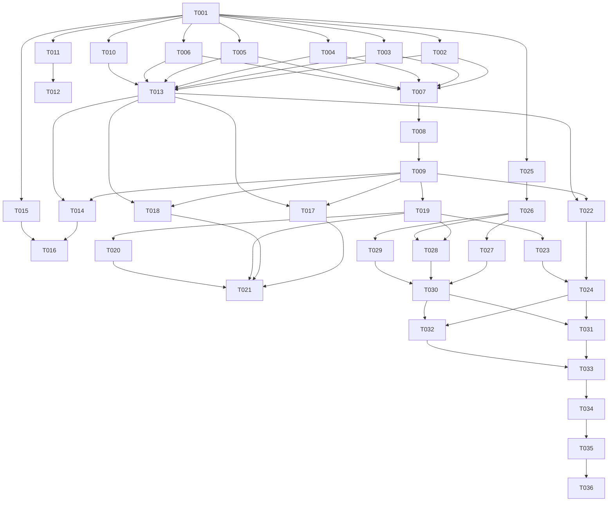

# Tasks: 我的页内容库（历史记录 / 我的收藏 / 稍后再看 / 离线缓存）

**Input**: Design documents from `spec/mine-library/`
**Prerequisites**: plan.md（已批准）、spec.md（已批准）
**Verification Scope**: build+ui（用户已选择 Run verification + UI verification）

**Organization**: 任务按用户故事分组（US1–US4，先易后难：历史→收藏→稍后再看→离线缓存），每故事可独立实现与验证。MVP = Setup + Foundational + US1。

## Format: `[ID] [P?] [Story] Description`

- **[P]**: 可并行（不同文件、无未完成依赖）
- **[Story]**: 所属用户故事（US1–US4）
- 所有路径相对仓库根 `F:\Work\OHProj\OhBili`

## Path Conventions

- common HAR：`common/src/main/ets/`（模型 `model/*.ets`、响应模型 `model/response/*.ts`、数据源 `model/DataSourceManager.ets`、网络 `network/Api.ts|TaskManager.ts|ApiManager.ets`、工具 `utils/*.ets`、组件 `components/**`）
- common 导出入口：`common/Index.ets`（HAR 根）
- phone 页面：`product/phone/src/main/ets/pages/*.ets`；路由注册 `product/phone/src/main/resources/base/profile/main_pages.json`
- tablet：`product/tablet/` 零改动（仅回归构建）

---

## Phase 1: Setup（基线）

**Purpose**: 基线构建验证，作为后续修复对照

- [X] T001 基线构建验证：运行 `devecocli build --modules phone` 确认当前工作区基线可构建，作为后续修复对照（注：DEVECO_HOME 环境变量指向无效 D: 盘路径，本会话内覆盖为 G:\Program Files\Huawei\DevEco Studio 后构建成功）

---

## Phase 2: Foundational（阻塞性基础）

**Purpose**: 4 个响应模型 + PlayUrl 扩展 + 网络层端点/任务/方法 + 数据源 + 导航与四宫格入口

**⚠️ CRITICAL**: 本阶段全部完成前，任何用户故事不得开始

- [X] T002 [P] 新增历史记录响应模型（HistoryResponse：HistoryItem[] 含 title/cover/author_face/author_name/view_at/progress/duration/aid/bvid/cid，history 子对象含实际 bvid/cid，非视频类型以 badge 与缺失 bvid 标识降级）到 common/src/main/ets/model/response/HistoryResponse.ts
- [X] T003 [P] 新增收藏夹列表响应模型（FavFolderResponse：data.list 为 FavFolder[] 含 id/media_id/title/media_count/fav_state，data.count 总数）到 common/src/main/ets/model/response/FavFolderResponse.ts
- [X] T004 [P] 新增收藏夹内容响应模型（FavResourceResponse：data.medias 为 FavMedia[] 含 bvid/title/cover/intro/duration/upper.name/fav_time/attr 时效标记，data.has_more 分页标志）到 common/src/main/ets/model/response/FavResourceResponse.ts
- [X] T005 [P] 新增稍后再看响应模型（WatchLaterResponse：data.list 为 WatchLaterItem[] 含 aid/bvid/title/cover/owner.name/add_dt/duration）到 common/src/main/ets/model/response/WatchLaterResponse.ts
- [X] T006 [P] 扩展播放地址响应模型：新增可选 accept_quality: number[]、accept_description: string[]、timelength（毫秒）字段到 common/src/main/ets/model/response/PlayUrlResponse.ts
- [X] T007 在 common/src/main/ets/network/Api.ts 新增 10 个端点声明：GET `x/v2/history`（pn/ps+Cookie）、POST `x/v2/history/del`（kid+csrf）、POST `x/v2/history/clear`（csrf）、GET `x/v3/fav/folder/created/list-all`（up_mid+Cookie）、GET `x/v3/fav/resource/list`（media_id/pn/ps/keyword/order/tid/platform=web+Cookie）、POST `x/v3/fav/resource/deal`（rid/type=2/add_media_ids/del_media_ids 逗号分隔/csrf）、GET `x/v2/history/toview/web`（Cookie）、POST `x/v2/history/toview/add`（aid+csrf）、POST `x/v2/history/toview/del`（aid+csrf）；扩展 getPlayUrl 增加可选 qn/platform=html5/high_quality=1/fnval=0 参数（响应类型绑定 T002–T006 模型）（依赖 T002–T006）（注：x/v2/history 服务端不支持 pn 分页，按 plan.md 决策改用 max/view_at 游标；getPlayUrl 扩展以独立 getPlayUrlWithQn 方法实现，避免 retrofit 空值参数污染既有播放链路）
- [X] T008 在 common/src/main/ets/network/TaskManager.ts 新增对应 taskPool 并发任务与包装方法（对齐既有任务模式：并发任务函数仅可引用导入变量，主线程解析）（依赖 T007）
- [X] T009 在 common/src/main/ets/network/ApiManager.ets 新增 9 个业务方法：requestHistory(pn,ps)/deleteHistory(kid)/clearHistory()/requestFavFolders(mid)/requestFavResources(mediaId,pn,ps)/favDeal(aid,addIds,delIds)/requestWatchLater()/addWatchLater(aid)/removeWatchLater(aid)；requestPlayUrl 增加可选 qn；csrf 取 AppStorage 'ohBiliBiliJct'，Cookie 复用 LoginHelper.buildCookieHeader()（依赖 T008）
- [X] T010 [P] 在 common/src/main/ets/model/DataSourceManager.ets 新增 HistoryDataSource（pn 分页）、FavMediaDataSource（pn 分页）、WatchLaterDataSource（全量单页），均对齐既有 BasicDataSource 子类模式
- [X] T011 [P] 在 common/src/main/ets/utils/NavHelper.ets 新增 goHistory()/goFavorite()/goWatchLater()/goOfflineCache() 四个导航方法（沿用既有 phone 设备门禁模式）
- [X] T012 在 common/src/main/ets/components/mine/MineOpt.ets 将四宫格改为可点击：离线缓存/历史记录/我的收藏/稍后再看分别调用 NavHelper 对应方法（依赖 T011）
- [X] T013 [P] 在 common/Index.ets 导出 T002–T005 新模型、T010 新数据源（HistoryDataSource/FavMediaDataSource/WatchLaterDataSource）（依赖 T002–T006、T010）

**Checkpoint**: 基础设施就绪，用户故事可开始

---

## Phase 3: User Story 1 - 浏览与管理历史记录 (P1) 🎯 MVP

**Goal**: 历史列表浏览（封面/标题/UP/时间/进度）+ 点击续播 + 单条删除 + 一键清空
**Independent Test**: 登录 → 我的页点"历史记录"→ 云端历史列表 → 点击一条进播放页从上次进度续播 → 返回删除该条（确认弹窗）→ 条目消失 → 清空全部 → 空态

- [X] T014 [P] [US1] 新增历史记录页到 product/phone/src/main/ets/pages/History.ets 并注册 product/phone/src/main/resources/base/profile/main_pages.json：未登录页内登录引导（不请求）；已登录 OhNavBar（右上角"清空"入口+AlertDialog 确认）+ HistoryDataSource + List/LazyForEach + 分页加载；条目含封面/标题/UP 主/观看时间/进度文案，行尾删除按钮+AlertDialog 确认（ApiManager.deleteHistory，kid=av{aid}）；非视频类型条目降级展示不可点击；空态/错误态可重试（依赖 T009、T013）（注：OhNavBar 无右槽，头部栏页内自绘同款结构实现右上角"清空"入口）
- [X] T015 [P] [US1] 续播支持：product/phone/src/main/ets/pages/Video.ets 路由参数新增可选 startAt（秒），透传 PlayerView；common/src/main/ets/components/video/Player.ets 在 prepared 后 startAt>0 时先 seek 再播放（依赖 T001 基线；与 T014 并行）
- [X] T016 [US1] 历史链路联调核查：History 条目点击 → Video(BaseVideo+startAt) 续播；单删/清空后列表刷新且云端同步；未登录引导正确（依赖 T014、T015）（核查通过：onItemClick 构造 BaseVideo(cid/bvid/startAt) → PlayerView PREPARED 后 seekTo；deleteData 本地移除+refresh 云端拉取；loginState 门禁不发起请求）

**Checkpoint**: 历史记录闭环可用（MVP）

---

## Phase 4: User Story 2 - 浏览与管理我的收藏 (P1)

**Goal**: 收藏夹列表 → 夹内容两级浏览 + 取消收藏 + 视频页收藏入口（多选夹）
**Independent Test**: 我的页点"我的收藏"→ 夹列表（名称/数量）→ 进夹看内容 → 点视频播放 → 取消收藏一条（确认）→ 视频页点收藏 → 多选夹确认 → 收藏成功状态即时反映

- [X] T017 [P] [US2] 新增收藏夹列表页到 product/phone/src/main/ets/pages/Favorite.ets 并注册 main_pages.json：未登录登录引导；已登录夹列表（id/media_id/title/media_count，点击跳 FavDetail 传 mediaId+title）；空态/错误态可重试（依赖 T009、T013）
- [X] T018 [P] [US2] 新增收藏夹内容页到 product/phone/src/main/ets/pages/FavDetail.ets 并注册 main_pages.json：路由参数 { mediaId, title }；FavMediaDataSource 分页列表（封面/标题/UP/收藏时间）；点击构造 BaseVideo 跳 pages/Video；失效视频（attr 标记）置灰不可点击；行尾取消收藏按钮+AlertDialog 确认（ApiManager.favDeal delIds）；空态/错误态（依赖 T009、T013）
- [X] T019 [US2] 新增视频页操作行组件到 common/src/main/ets/components/video/VideoActionRow.ets：三个按钮（收藏/稍后再看/缓存，后两者本期占位禁用）；收藏按钮弹收藏夹多选 CustomDialog（ApiManager.requestFavFolders 拉取，fav_state 预勾选；确认时 favDeal 提交 add/del 差集；失败 toast 提示），成功后按钮态即时更新；在 common/Index.ets 导出 VideoActionRow（依赖 T009）
- [X] T020 [US2] 在 product/phone/src/main/ets/pages/Video.ets 接入 VideoActionRow（视频信息区下方）（依赖 T019）
- [X] T021 [US2] 收藏链路联调核查：夹列表→夹内容→播放；夹内取消收藏计数更新；视频页收藏/取消收藏状态即时反映；未登录引导正确（依赖 T017–T020）

**Checkpoint**: 收藏两级页面与视频页入口闭环

---

## Phase 5: User Story 3 - 浏览与管理稍后再看 (P2)

**Goal**: 稍后再看列表 + 点击播放 + 单条移除 + 视频页添加/移除入口
**Independent Test**: 我的页点"稍后再看"→ 列表 → 点条目播放 → 返回移除一条（确认）→ 消失；视频页点"稍后再看"→ toast 添加成功 → 列表出现该视频

- [X] T022 [P] [US3] 新增稍后再看页到 product/phone/src/main/ets/pages/WatchLater.ets 并注册 main_pages.json：未登录登录引导；已登录 WatchLaterDataSource 全量列表（封面/标题/UP/添加时间）；点击构造 BaseVideo 跳 pages/Video；行尾移除按钮+AlertDialog 确认（ApiManager.removeWatchLater）；失效条目置灰；空态/错误态可重试（依赖 T009、T013）
- [X] T023 [US3] 在 common/src/main/ets/components/video/VideoActionRow.ets 启用"稍后再看"按钮：点击 ApiManager.addWatchLater(aid) 即时添加+toast"已加入稍后再看"；失败 toast 错误（依赖 T019）
- [X] T024 [US3] 稍后再看链路联调核查：列表→播放；视频页添加→列表出现；移除同步；未登录引导正确（依赖 T022、T023）

**Checkpoint**: 稍后再看闭环

---

## Phase 6: User Story 4 - 完整离线缓存 (P2)

**Goal**: 视频页缓存入口（清晰度选择+预估大小）→ 串行下载（进度可见）→ 缓存管理页（存储占用/删除）→ 断网/未登录本地播放
**Independent Test**: 视频页点"缓存"→ 选清晰度 → 确认大小 → 下载进度 → 缓存页见任务与占用 → 完成后断网点击 → 本地完整播放 → 删除 → 占用减少

- [X] T025 [P] [US4] 新增离线缓存任务本地模型（CacheTask：id=bvid_cid_qn/bvid/cid/aid/title/cover/upName/quality/qualityDesc/状态 WAITING|DOWNLOADING|COMPLETED|FAILED/receivedBytes/totalBytes/localDir/fileName/createTime）到 common/src/main/ets/model/CacheTask.ets
- [X] T026 [US4] 新增串行下载管理器到 common/src/main/ets/utils/DownloadManager.ets：单例；`@ohos.request.agent` 单文件下载（header 带 UA+Referer）；App 层串行队列（同时仅 1 个下载中）；任务状态/进度监听器注册注销；`filesDir/offline/index.json` 元数据持久化与启动恢复（校验文件存在性，DOWNLOADING 中断残留降级为 FAILED）；remove 删除任务并清理文件；getTotalSize 聚合存储占用；在 common/Index.ets 导出 DownloadManager 与 CacheTask（依赖 T025）
- [X] T027 [US4] 新增离线缓存管理页到 product/phone/src/main/ets/pages/OfflineCache.ets 并注册 main_pages.json：未登录仍可查看已缓存内容（本地数据不要求登录）；任务列表（封面/标题/清晰度/状态与进度条/大小）；行尾删除按钮+AlertDialog 确认（DownloadManager.remove）；顶部存储占用统计；FAILED 条目提供重试（重新入队）；COMPLETED 条目点击跳 Video 本地播放；空态（依赖 T026）
- [X] T028 [US4] 在 common/src/main/ets/components/video/VideoActionRow.ets 启用"缓存"按钮：弹清晰度选择 CustomDialog（requestPlayUrl 响应 accept_quality/accept_description 驱动档位列表）；选定后请求该 qn 的 playurl，展示 durl.size 预估大小二次确认；确认后构造 CacheTask 并 DownloadManager.enqueue 入队+toast（依赖 T019、T026）
- [X] T029 [US4] 本地播放链路：common/src/main/ets/components/video/Player.ets 新增 localPath 分支（跳过 requestPlayUrl，直接 initPlay 本地文件）；common/src/main/ets/player/AvPlayer.ets 新增本地文件支持（fs.open 取 fd 走 fdSrc）；IjkPlayer 本地路径直接播放；product/phone/src/main/ets/pages/Video.ets 路由参数新增可选 localPath 透传 Player（依赖 T015、T026）
- [X] T030 [US4] 离线缓存端到端联调核查：缓存入队→进度推进→完成；断网后 OfflineCache 点击完整本地播放；删除后占用减少且文件清理；下载中断→FAILED→重试/删除；未登录可播已缓存内容（依赖 T027–T029）

**Checkpoint**: 离线缓存完整闭环，四宫格全部可用

---

## Phase 7: Polish（收尾）

**Purpose**: 影响多个用户故事的横切收尾

- [X] T031 [P] 在 common/Index.ets 核查导出完整性：本轮全部新增公共符号（响应模型/数据源/CacheTask/DownloadManager/VideoActionRow）均已导出，无遗漏无冗余（依赖 T024、T030）
- [X] T032 [P] 破坏性操作二次确认走查（FR-008）：核查删除历史/清空历史/取消收藏/移除稍后再看/删除缓存共 5 类操作全部具备 AlertDialog 确认；清理临时调试日志（依赖 T030）

---

## Phase 8: Verification

<!-- verification_scope: build+ui -->

**Purpose**: 构建 + 回归 + 部署 + 按用户故事 UI 验证（用户已选择 build+ui）

- [X] T033 构建修复循环：运行 `devecocli build --modules phone`，对编译错误迭代修复→重建直至成功
- [X] T034 tablet 回归构建：运行 `devecocli build --modules tablet` 确认零源码改动下可构建（FR-011）
- [X] T035 部署模拟器：运行 `devecocli run --skip-build --module phone --device 127.0.0.1:5555`，force-stop 后冷启动 com.wathinst.ohbili
- [X] T036 UI 验证：对已部署应用按 US1–US4 用户故事逐条执行 verify_ui 用例（历史列表/续播/删除/清空；收藏夹两级/视频页收藏；稍后再看列表/添加/移除；离线缓存下载/进度/断网本地播放/删除）

---

## Dependencies & Execution Order

### Phase Dependencies

- **Setup (Phase 1)**: 无依赖，可立即开始
- **Foundational (Phase 2)**: 依赖 Phase 1 —— **阻塞全部用户故事**
- **User Stories (Phases 3–6)**: 依赖 Foundational 完成；按先易后难顺序执行（US1→US2→US3→US4）
- **Polish (Phase 7)**: 依赖全部用户故事完成
- **Verification (Phase 8)**: 依赖 Phase 1–7 全部完成

### User Story Dependencies

- **US1 (P1)**: Foundational 后即可开始，不依赖其他故事；T015（Player/Video startAt）与 T014 可并行
- **US2 (P1)**: Foundational 后即可开始；与 US1 无文件冲突可并行推进；VideoActionRow（T019）在 US2 创建，"稍后再看/缓存"按钮占位，US3/US4 启用
- **US3 (P2)**: 依赖 US2 的 VideoActionRow（T019）；页面（T022）可先行并行
- **US4 (P2)**: 依赖 US2 的 VideoActionRow（T019）与 US1 的 Player 改动（T015）；DownloadManager/OfflineCache 页（T026/T027）可与 T028/T029 并行准备

### Within Each User Story

- 页面/组件任务先行（标记 [P] 并行），链路联调任务（T016/T021/T024/T030）收口
- 每故事 Checkpoint 处可独立人工验证

### Parallel Opportunities

- Foundational：T002–T006 五个模型任务并行（T006 为既有文件扩展，无冲突）；T010/T011/T013 与 T007–T009 串行链并行；T012 待 T011 完成后执行
- US1：T014（History 页）与 T015（Player 续播）并行
- US2：T017/T018/T019 三任务并行（不同文件），T020/T021 收口
- US4：T025 先行，T026/T028/T029 在 T025/T019 就绪后并行推进，T030 收口

### 📊 Dependency Graph



---

## Parallel Example: Foundational 阶段与 US2

```bash
# Foundational：五个模型任务并行发起
Task: "新增历史记录响应模型到 common/src/main/ets/model/response/HistoryResponse.ts"        # T002
Task: "新增收藏夹列表响应模型到 common/src/main/ets/model/response/FavFolderResponse.ts"     # T003
Task: "新增收藏夹内容响应模型到 common/src/main/ets/model/response/FavResourceResponse.ts"   # T004
Task: "新增稍后再看响应模型到 common/src/main/ets/model/response/WatchLaterResponse.ts"      # T005
Task: "扩展 PlayUrlResponse 到 common/src/main/ets/model/response/PlayUrlResponse.ts"        # T006
# 同时并行：DataSourceManager 数据源（T010）与 NavHelper 导航（T011）

# US2：三个不同文件任务并行发起
Task: "新增收藏夹列表页 product/phone/src/main/ets/pages/Favorite.ets"                        # T017
Task: "新增收藏夹内容页 product/phone/src/main/ets/pages/FavDetail.ets"                       # T018
Task: "新增视频页操作行组件 common/src/main/ets/components/video/VideoActionRow.ets"          # T019
```

---

## Implementation Strategy

### MVP First (User Story 1 Only)

1. Complete Phase 1: Setup（T001 基线构建）
2. Complete Phase 2: Foundational（T002–T013，CRITICAL - 阻塞所有故事）
3. Complete Phase 3: User Story 1（T014–T016）
4. **STOP and VALIDATE**: 登录后"我的"→"历史记录"，独立验证列表/续播/删除/清空
5. Deploy/demo if ready

### Incremental Delivery

1. Setup + Foundational → 基础设施就绪
2. US1 → 独立验证 → 部署演示（MVP：历史记录闭环）
3. US2 → 独立验证 → 收藏两级页面+视频页收藏入口
4. US3 → 独立验证 → 稍后再看闭环
5. US4 → 独立验证 → 离线缓存完整闭环（最重，压轴）
6. Polish + Verification → 交付

### Parallel Team Strategy

多执行者并行时：

1. 团队共同完成 Setup + Foundational
2. Foundational 完成后：
   - 执行者 A：US1（T014–T016）
   - 执行者 B：US2（T017–T021）
   - 执行者 C：US4 基础件（T025、T026）
3. US3 依赖 T019 完成后接入；US4 播放链路（T029）待 T015 完成后推进
4. 各故事独立完成后进入 Polish + Verification

---

## Notes

- [P] 任务 = 不同文件、无依赖
- [Story] 标签将任务映射到具体用户故事，保证可追溯
- 每个用户故事可独立完成、独立验证
- 任务总数 36：Setup 1 / Foundational 12 / US1 3 / US2 5 / US3 3 / US4 6 / Polish 2 / Verification 4
- 验证范围标记 `<!-- verification_scope: build+ui -->` 已按用户选择写入 Verification 阶段
- VideoActionRow 采用"US2 创建（收藏功能+占位）/US3 启用稍后再看/US4 启用缓存"渐进策略，避免跨故事同文件冲突
- Player.ets/Video.ets 在 US1（startAt 续播）与 US4（localPath 本地播放）各改一次，注意合并顺序（T029 依赖 T015）
- tablet 零源码改动（FR-011）：NavHelper 设备门禁保证 common 组件在 tablet 上静默；T034 仅回归构建
- 历史/收藏/稍后再看端点若遇 -352/-403 风控，按 plan.md 决策 6 补 WbiSigner 签名与浏览器头
- 避免：模糊任务、同文件冲突、破坏故事独立性的跨故事依赖
