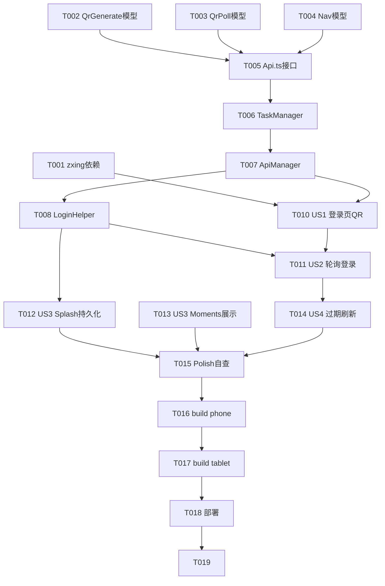

# Tasks: B站扫码登录（QR Login）

**Input**: Design documents from `spec/qr-login/`
**Prerequisites**: plan.md (required), spec.md (required for user stories)

## Format: `[ID] [P?] [Story] Description`

- **[P]**: Can run in parallel (different files, no dependencies)
- **[Story]**: Which user story this task belongs to (e.g., US1, US2, US3)
- Include exact file paths in descriptions

## Path Conventions

- 多模块工程：公共代码位于 `common/src/main/ets/`（HAR），页面位于 `product/phone/src/main/ets/`
- 响应模型目录：`common/src/main/ets/model/response/`
- 网络层目录：`common/src/main/ets/network/`
- 通用工具目录：`common/src/main/ets/utils/`
- 文中所有路径均相对仓库根 `F:\Work\OHProj\OhBili`

---

## Phase 1: Setup (Shared Infrastructure)

**Purpose**: 依赖与配置就绪

- [X] T001 在 `product/phone/oh-package.json5` 的 dependencies 中新增 `"@ohos/zxing": "^2.1.6"`，执行 ohpm install 并确认 zxing har 成功解包到 `product/phone/oh_modules`

---

## Phase 2: Foundational (Blocking Prerequisites)

**Purpose**: 网络层与凭证辅助，全部用户故事的前置

**⚠️ CRITICAL**: 本阶段完成前不得开始任何用户故事

- [X] T002 [P] 创建响应模型 `common/src/main/ets/model/response/QrCodeGenerateResponse.ts`（QrCodeData: url/qrcode_key，继承 BaseResponse，风格对齐 `SmsLoginResponse.ts`）
- [X] T003 [P] 创建响应模型 `common/src/main/ets/model/response/QrPollResponse.ts`（QrPollData: url/refresh_token/timestamp/code/message）
- [X] T004 [P] 创建响应模型 `common/src/main/ets/model/response/NavResponse.ts`（NavData: isLogin/mid/uname/face）
- [X] T005 在 `common/src/main/ets/network/Api.ts` DataService 新增 3 个接口：generateQrCode（GET /x/passport-login/web/qrcode/generate）、pollQrCode（GET /x/passport-login/web/qrcode/poll，@Query qrcode_key）、getNavInfo（GET x/web-interface/nav，@Header Cookie），endpoint 沿用 @BasePath 与 ApiConstants 域名拼接模式
- [X] T006 在 `common/src/main/ets/network/TaskManager.ts` 新增 3 个 taskPool 并发任务（"use concurrent"）与对应封装方法，完全对齐现有 SendSmsCaptcha 任务模式
- [X] T007 在 `common/src/main/ets/network/ApiManager.ets` 新增 3 个 async 包装：requestQrCode(): Promise<QrCodeData>、pollQrStatus(qrcodeKey): Promise<QrPollResponse>、requestNavInfo(cookie): Promise<NavData>，含 BLog 日志与错误兜底（失败返回 null）
- [X] T008 创建 `common/src/main/ets/utils/LoginHelper.ets`：parseCrossDomainCookies(url)（解析 crossDomain query 参数）、buildCookieHeader()、saveLoginCredentials(params, refreshToken)、clearLoginCredentials()、validateAndRestoreLoginState()（调 requestNavInfo 校验并恢复/刷新 uname/face，失败清凭证），并在 `common/src/main/ets/index.ets` 导出
- [X] T009 确认 `common/oh-package.json5` 无需改动（zxing 仅 phone 使用），且 common 模块对 @ohos/common 导出无破坏

**Checkpoint**: 网络层三条链路（generate/poll/nav）与凭证辅助可独立调用，用户故事可开始

---

## Phase 3: User Story 1 - 展示二维码登录页 (Priority: P1) 🎯 MVP

**Goal**: 进入登录页即可看到可扫描的 B 站登录二维码

**Independent Test**: 动态页 → 点击"登录" → 登录页展示二维码（3 秒内可见，可用 B 站 App 识别出登录确认页）

- [X] T010 [US1] 重写 `product/phone/src/main/ets/pages/Login.ets`：移除全部短信登录 UI（CountryPicker/手机号输入/验证码输入），保留 OhNavBar("扫码登录")；aboutToAppear 调 ApiManager.requestQrCode() 取 url/qrcode_key，用 @ohos/zxing 生成 PixelMap 于白底卡片（约 240vp）展示，附文案"请使用B站App扫码登录"；loading 态显示加载提示；接口失败 toast"网络异常，请重试"并提供点击重试

**Checkpoint**: 二维码可见可扫（MVP 最小切片达成）

---

## Phase 4: User Story 2 - 扫码并确认登录 (Priority: P1)

**Goal**: B 站 App 扫码确认后完成登录并保存凭证

**Independent Test**: B 站 App 扫码 → 页面出现"已扫码"提示 → 手机确认 → toast"登录成功" → 返回动态页不再显示未登录

- [X] T011 [US2] 在 `product/phone/src/main/ets/pages/Login.ets` 增加轮询：setInterval 3000ms 调 ApiManager.pollQrStatus()，处理业务码——86101 保持 waiting 文案、86090 显示"已扫码，请在手机上确认"、code=0 成功：LoginHelper.parseCrossDomainCookies 解析 data.url → LoginHelper.saveLoginCredentials 保存凭证（含 refresh_token）→ toast"登录成功"→ router.back()；aboutToDisappear 清除定时器（FR-007）；轮询网络错误连续 ≥3 次暂停并提示重试（FR-008）

**Checkpoint**: 扫码 → 确认 → 登录成功 → 凭证保存的完整闭环

---

## Phase 5: User Story 3 - 登录态持久化与用户信息展示 (Priority: P2)

**Goal**: 重启后登录态保持；动态页展示昵称与头像

**Independent Test**: 扫码登录成功 → 杀进程重启 → 动态页仍显示已登录且展示昵称头像

- [X] T012 [US3] 修改 `product/phone/src/main/ets/pages/Splash.ets`：storageInit() 新增 7 个 PersistProp（isOhBiliLoggedIn=false、ohBiliSessdata/ohBiliBiliJct/ohBiliDedeUserId/ohBiliRefreshToken/ohBiliUname/ohBiliFace=""）；initTask() 追加异步调用 LoginHelper.validateAndRestoreLoginState()（不阻塞 1 秒跳转）
- [X] T013 [US3] 修改 `product/phone/src/main/ets/pages/Moments.ets`：已登录分支展示头像 Image（@StorageLink ohBiliFace 网络图，圆形，约 64vp）+ 昵称（@StorageLink ohBiliUname）；未登录分支保持现状不变

**Checkpoint**: SC-003 达成 —— 重启 100% 保持登录态且动态页展示昵称头像

---

## Phase 6: User Story 4 - 二维码过期与刷新 (Priority: P2)

**Goal**: 二维码过期有明确提示并可刷新

**Independent Test**: 登录页停留超有效期（约 180 秒）→ 出现"二维码已过期，点击刷新" → 点击后重新生成二维码并恢复轮询

- [X] T014 [US4] 在 `product/phone/src/main/ets/pages/Login.ets` 增加 86038 过期处理：二维码上叠加半透明遮罩与"二维码已过期 点击刷新"入口，点击后重新走 requestQrCode 流程并重启轮询

**Checkpoint**: 全部用户故事完成

---

## Phase 7: Polish & Cross-Cutting Concerns

**Purpose**: 跨故事收尾与质量兜底

- [X] T015 静态自查新增/改写文件（Login.ets / LoginHelper.ets / 三个模型 / Api/TaskManager/ApiManager 增量）是否符合 ArkTS 约束：无 any/未类型化对象字面量、taskPool 任务参数可序列化、@Builder/build 内无副作用语句；确认 tablet 模块未引用任何新增符号（common 为共享 HAR，需保证增量不破坏 tablet 编译）

---

## Phase 8: Verification

<!-- verification_scope: build+ui -->

**Purpose**: 构建、部署并 UI 验证已实现的特性

- [X] T016 构建并修复编译错误：`devecocli build --modules phone`（必要时迭代修复直至成功）
- [X] T017 回归构建 tablet 模块（common HAR 被改动）：`devecocli build --modules tablet`
- [X] T018 部署到真机（nova 14 Ultra）：`devecocli run --skip-build`（如签名缺失先执行 `devecocli signature generate`）
- [X] T019 对已部署应用执行 UI 验证（verify_ui）：验证登录页二维码展示、动态页未登录/已登录两种状态渲染

---

## Dependencies & Execution Order

### Phase Dependencies

- **Setup (Phase 1)**: 无依赖，立即开始
- **Foundational (Phase 2)**: 依赖 Phase 1（T001 供 Login 页 zxing 使用；模型/网络链路供全部故事使用）
- **User Stories (Phase 3–6)**: 全部依赖 Phase 2 完成；故事间按优先级串行推进（P1 → P2），US3 内部两任务可并行
- **Polish (Phase 7)**: 依赖全部用户故事完成
- **Verification (Phase 8)**: 依赖 Polish 完成

### User Story Dependencies

- **US1 (P1)**: 依赖 Foundational（T001/T007）；无跨故事依赖
- **US2 (P1)**: 依赖 US1 的页面骨架（同文件增量）与 T008
- **US3 (P2)**: 依赖 T008；与 US1/US2 无文件冲突，但凭证保存语义依赖 US2 完成才能端到端验证
- **US4 (P2)**: 依赖 US2 的轮询逻辑（同文件增量）

### Within Each User Story

- 模型先行（Foundational 已统一完成）
- 页面骨架（US1）→ 轮询闭环（US2）→ 过期处理（US4），Login.ets 内串行增量
- 每个故事完成后在 checkpoint 单独验证

---

## Parallel Example: User Story 1

```bash
# 模型三件套可并行（Foundational）：
Task: "创建 QrCodeGenerateResponse.ts"
Task: "创建 QrPollResponse.ts"
Task: "创建 NavResponse.ts"

# US3 两文件可并行：
Task: "修改 Splash.ets 增加持久化与登录态恢复"
Task: "修改 Moments.ets 增加已登录展示"
```

---

## Implementation Strategy

### MVP First (User Story 1 + 2)

1. 完成 Phase 1 Setup（zxing 依赖）
2. 完成 Phase 2 Foundational（网络层三链路 + LoginHelper）
3. 完成 US1（二维码展示）→ 真机验证二维码可扫
4. 完成 US2（扫码登录闭环）→ 真机验证登录成功
5. **STOP and VALIDATE**: MVP 可交付

### Incremental Delivery

1. Setup + Foundational → 基础就绪
2. US1 + US2 → MVP（扫码登录闭环）
3. US3 → 持久化与用户信息展示
4. US4 → 过期刷新体验补全
5. Polish + Verification → 交付

---

## 📊 Dependency Graph



## ⚡ Parallel Execution Guide

| Phase | Tasks | Required Files | Execution Notes |
|---|---|---|---|
| Foundational | T002, T003, T004 | 3 个独立模型文件 | 可完全并行 |
| User Story 3 | T012, T013 | Splash.ets / Moments.ets | 不同文件，T008 完成后可并行 |

## Summary Report

- **总任务数**: 19（T001–T019）
- **每故事任务数**: US1=1 / US2=1 / US3=2 / US4=1 / Setup=1 / Foundational=8 / Polish=1 / Verification=4
- **并行机会**: 模型三件套（T002-T004）、US3 双文件（T012-T013）
- **独立测试标准**: 每个故事 checkpoint 均可在真机单独验证（见各 Phase Independent Test）
- **建议 MVP 范围**: T001–T011（二维码展示 + 扫码登录闭环）

## Notes

- Login.ets 为单文件多故事增量改写（T010→T011→T014 串行），同文件任务不可并行
- 所有新增网络代码沿用 common 模块既有模式（retrofit + taskPool + ApiResponse 包装）
- 状态管理保持 V1（@State/@StorageLink/PersistentStorage），不得混入 V2 装饰器
