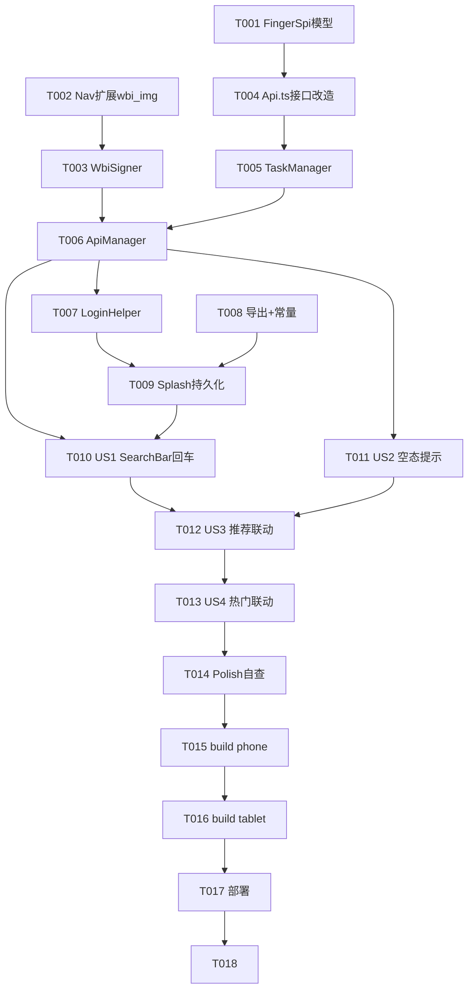

# Tasks: 对齐 B 站网页版数据源（Web API Alignment）

**Input**: Design documents from `spec/web-api-align/`
**Prerequisites**: plan.md (required), spec.md (required for user stories)

## Format: `[ID] [P?] [Story] Description`

- **[P]**: Can run in parallel (different files, no dependencies)
- **[Story]**: Which user story this task belongs to (e.g., US1, US2, US3)
- Include exact file paths in descriptions

## Path Conventions

- 多模块工程：公共代码位于 `common/src/main/ets/`（HAR），页面位于 `product/phone/src/main/ets/`
- 响应模型目录：`common/src/main/ets/model/response/`
- 网络层目录：`common/src/main/ets/network/`
- 通用工具目录：`common/src/main/ets/utils/`
- 文中所有路径均相对仓库根 `F:\Work\OHProj\OhBili`

---

## Phase 1: Foundational (Blocking Prerequisites)

**Purpose**: WBI 签名与设备 Cookie 基础设施，全部用户故事的前置

**⚠️ CRITICAL**: 本阶段完成前不得开始任何用户故事

- [X] T001 [P] 创建响应模型 `common/src/main/ets/model/response/FingerSpiResponse.ts`（FingerSpiData: b_3/b_4，BaseResponse 风格）
- [X] T002 [P] 扩展响应模型 `common/src/main/ets/model/response/NavResponse.ts`：NavData 新增 `wbi_img?: WbiImg`（WbiImg: img_url/sub_url）
- [X] T003 [P] 创建 WBI 签名器 `common/src/main/ets/utils/WbiSigner.ets`：内置 64 项 mixinKey 置换表；getWbiKeys(forceRefresh)（经 ApiManager.requestNavInfo 复用 nav 链路提取 img_key/sub_key，内存缓存）；signParams(params: Record<string,string>)（wts 时间戳、值过滤 !'()*、键排序、URL 编码拼接、MD5 摘要 @kit.CryptoArchitectureKit cryptoFramework、产出 w_rid）；无密钥时降级返回原参数并 BLog 告警
- [X] T004 在 `common/src/main/ets/network/Api.ts` DataService 新增 `getFingerSpi`（GET x/frontend/finger/spi）；修改 `getSearch`（端点切至 x/web-interface/wbi/search/type，参数扩展 cookie/wRid/wts）；修改 `getRecommend`（参数扩展 cookie/fresh_idx_1h/fresh_idx_4h/fresh_type/feed_version/wRid/wts）；修改 `getPopular`（参数扩展 cookie）
- [X] T005 在 `common/src/main/ets/network/TaskManager.ts`：新增 requestFingerSpi 任务与方法（"use concurrent" taskPool 模式）；requestSearchTask 参数扩展（cookie 透传 + wRid/wts）；requestRecommendTask 参数扩展；requestPopularTask 参数扩展
- [X] T006 在 `common/src/main/ets/network/ApiManager.ets`：新增 requestFingerSpi()（失败返回 null）；requestSearch 移除硬编码假 Cookie，改用 LoginHelper.buildCookieHeader() + WbiSigner.signParams({search_type, keyword, page}) 签名透传；requestRecommend 扩展签名参数集（feed_version=V2、fresh_type=4、fresh_idx 系列会话级维护）+ Cookie；requestPopular 传 ps=20（ApiConstants 新增常量 popularPageSize=20）+ Cookie
- [X] T007 修改 `common/src/main/ets/utils/LoginHelper.ets`：buildCookieHeader() 并入 ohBiliBuvid3/ohBiliBuvid4（空值跳过）+ 登录 Cookie；新增 ensureDeviceCookies()（buvid 键为空时调 ApiManager.requestFingerSpi 持久化写入，失败随机 UUID 兜底并 BLog 告警）
- [X] T008 在 `common/Index.ets` 导出 FingerSpiResponse/FingerSpiData、WbiSigner；在 `common/src/main/ets/network/ApiConstants.ts` 新增 popularPageSize=20
- [X] T009 修改 `product/phone/src/main/ets/pages/Splash.ets`：storageInit() 新增 PersistProp（ohBiliBuvid3/ohBiliBuvid4，默认 ""）；initTask() 追加异步 LoginHelper.ensureDeviceCookies()（不阻塞跳转）

**Checkpoint**: WBI 签名 + 真实 Cookie 链路就绪，网络层三条请求（search/recommend/popular）均携带签名与 Cookie

---

## Phase 2: User Story 1 - 回车搜索正常出结果 (Priority: P1) 🎯 MVP

**Goal**: 输入法回车与点击"搜索"按钮行为与结果 100% 一致

**Independent Test**: 搜索页输入中文关键字（输入法候选上屏）→ 按回车 → 结果与按钮触发一致

- [X] T010 [US1] 修改 `common/src/main/ets/components/home/SearchBar.ets`：onSubmit 使用提交事件携带文本（经文档确认 API 26 TextInput.onSubmit 的 SubmitEvent.text 可用性后采用；事件文本优先、this.keyword 兜底）；searchKeyword() 增加 BLog 日志记录导航关键字；空关键字与 placeholder 分支行为保持

**Checkpoint**: 回车/按钮搜索行为收敛一致（FR-003）

---

## Phase 3: User Story 2 - 搜索结果对齐网页版 (Priority: P1)

**Goal**: 搜索结果与 B 站网页版综合排序一致，不因风控空结果

**Independent Test**: 对比同一关键字应用与网页版搜索首页结果，重合度 ≥80%

- [X] T011 [US2] 修改 `product/phone/src/main/ets/pages/SearchResult.ets`：加载完成且数据源为空时展示区分态提示（"无结果" / "请求过于频繁，请稍后再试"——依据 ApiManager 返回/风控码传递），替代空白列表；分页逻辑（pn 递增/上拉加载）保持现状

**Checkpoint**: 搜索数据源对齐 + 空态/风控友好提示（FR-004/FR-007）

---

## Phase 4: User Story 3 - 首页推荐对齐网页版 (Priority: P2)

**Goal**: 推荐流内容池与刷新行为与网页版一致（未登录热门向/已登录个性化）

**Independent Test**: 对比应用推荐流与网页版首页推荐内容风格；连续下拉刷新 5 次不重复

- [X] T012 [US3] 验证 `product/phone/src/main/ets/pages/Recommend.ets` 与改造后 ApiManager.requestRecommend 的联动：fresh_idx 会话级递增正确传递、下拉刷新（setData）与上拉加载（addAllData）不中断；若页面调用参数需适配 freshIdx 语义则最小调整该页面，否则不改动

**Checkpoint**: 推荐流对齐网页版（FR-005）

---

## Phase 5: User Story 4 - 热门对齐网页版 (Priority: P2)

**Goal**: 热门分页参数与条目顺序与网页版一致

**Independent Test**: 对比应用热门与网页版热门第一页条目集合与顺序

- [X] T013 [US4] 验证 `product/phone/src/main/ets/pages/Popular.ets` 与改造后 ApiManager.requestPopular 的联动：ps=20 生效、pn 分页连续不重复；若页面传参需适配则最小调整，否则不改动

**Checkpoint**: 热门对齐网页版（FR-006）

---

## Phase 6: Polish & Cross-Cutting Concerns

**Purpose**: 跨故事收尾与质量兜底

- [X] T014 静态自查全部新增/修改文件：无 any/未类型化对象字面量、Record 键访问合法（不用 in 探测/非 Record 索引）、taskPool 参数可序列化、WbiSigner 无 this 泄漏（arkts-no-standalone-this）；确认 tablet 模块无新增符号引用破坏（common 共享 HAR 回归）；移除 requestSearch 中硬编码 Cookie 字符串的残留引用

---

## Phase 7: Verification

<!-- verification_scope: build+ui -->

**Purpose**: 构建、部署并 UI 验证已实现的特性

- [X] T015 构建并修复编译错误：`devecocli build --modules phone`（迭代修复直至成功）
- [X] T016 回归构建 tablet 模块（common HAR 被改动）：`devecocli build --modules tablet`
- [X] T017 部署到真机（nova 14 Ultra，serial 54RUT25529005845）：`devecocli run --skip-build`（如签名缺失先 `devecocli signature generate`；如设备未连接，报告中注明并跳过）<!-- 实际部署目标：模拟器 Mate 90 Pro (127.0.0.1:5555)，真机 nova 14 Ultra 未连接，已在报告中注明 -->
- [X] T018 对已部署应用执行 UI 验证（verify_ui）：验证搜索页回车触发行为、搜索结果页渲染与空态提示、首页推荐/热门列表渲染与翻页<!-- Phase 1 逐故事验证 + Phase 2 全故事复验均通过：US1 PASS(2/3) US2 PASS(1/3) US3 PASS(3/3) US4 PASS(2/3)；Phase 2 复验 US1-US4 全 PASS -->

---

## Dependencies & Execution Order

### Phase Dependencies

- **Foundational (Phase 1)**: 无外部依赖，立即开始；T001/T002/T003 可并行，T004→T005→T006 串行，T007 依赖 T006（requestFingerSpi），T008/T009 收尾
- **User Stories (Phase 2–5)**: 全部依赖 Phase 1 完成；US1–US4 相互独立，按优先级推进
- **Polish (Phase 6)**: 依赖全部用户故事完成
- **Verification (Phase 7)**: 依赖 Polish 完成

### User Story Dependencies

- **US1 (P1)**: 依赖 Foundational 完成后的可构建状态；与 US2 数据层改动无文件冲突（SearchBar vs SearchResult）
- **US2 (P1)**: 数据源对齐主体在 Foundational 已完成，本阶段为 UI 空态补充
- **US3 (P2)**: 数据源在 Foundational 已完成，本阶段为页面联动验证与最小适配
- **US4 (P2)**: 同 US3

### Within Each User Story

- 模型/签名器先行（Foundational 统一完成）
- 页面适配在数据层就绪后进行
- 每个故事完成后在 checkpoint 独立验证

---

## Parallel Example: Foundational

```bash
# 模型与签名器可并行（不同文件）：
Task: "创建 FingerSpiResponse.ts"
Task: "扩展 NavResponse.ts"
Task: "创建 WbiSigner.ets"

# 用户故事页面任务可与 Polish 前的其他故事并行（不同文件）：
Task: "修改 SearchBar.ets（US1）"
Task: "修改 SearchResult.ets（US2）"
```

---

## Implementation Strategy

### MVP First (User Story 1 + 2)

1. 完成 Phase 1 Foundational（WBI 签名 + 设备 Cookie + 三接口改造）
2. 完成 US1（回车修复）→ 真机验证回车与按钮一致
3. 完成 US2（空态提示）→ 真机对比网页版搜索结果
4. **STOP and VALIDATE**: 搜索体验 MVP 交付

### Incremental Delivery

1. Foundational → 基础设施就绪
2. US1 + US2 → 搜索对齐 MVP
3. US3 + US4 → 推荐/热门对齐
4. Polish + Verification → 交付

---

## 📊 Dependency Graph



## ⚡ Parallel Execution Guide

| Phase | Tasks | Required Files | Execution Notes |
|---|---|---|---|
| Foundational | T001, T002, T003 | 3 个独立新文件 | 可完全并行（T002 完成后 T003 方可调 nav 链路，T003 也可先写置换表与算法后接链路） |
| User Stories | T010, T011 | SearchBar.ets / SearchResult.ets | 不同文件，Foundational 完成后可并行 |

## Summary Report

- **总任务数**: 18（T001–T018）
- **每故事任务数**: US1=1 / US2=1 / US3=1 / US4=1 / Foundational=9 / Polish=1 / Verification=4
- **并行机会**: Foundational 三新文件（T001-T003）、US 页面双文件（T010-T011）
- **独立测试标准**: 每个故事 checkpoint 均可在真机单独验证（见各 Phase Independent Test）
- **建议 MVP 范围**: T001–T011（WBI/Cookie 基建 + 搜索回车修复 + 搜索对齐）

## Notes

- WbiSigner 的置换表与签名算法为 B 站 Web 端公开标准实现；实现时需严格按算法步骤（wts → 过滤 → 排序 → 编码 → MD5）逐步验证
- 所有签名计算在 ApiManager（主线程异步）完成，taskPool 任务仅透传已签名参数，避免在并发任务内引入 cryptoFramework 依赖
- 硬编码假 Cookie 必须在本轮完全移除（T006/T014 双重确认）
- tablet 模块源码零改动；common 改动后的 tablet 回归构建在 Verification 阶段执行
